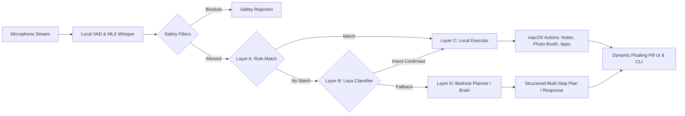

# FLASH AI ⚡

> **Fast Intelligence. Instant Action.**  
> A privacy-first, low-latency voice assistant and desktop automation engine built natively for macOS.

[]()
[](LICENSE)
[]()
[]()
[]()

---

## 1. Overview & Purpose

**FLASH AI** is an open-source, local-first voice assistant tailored for macOS. Unlike cloud-centric voice assistants that send raw audio over the network, FLASH AI runs speech recognition and intent classification **completely on device** using Apple Silicon hardware acceleration.

It bridges fast local command execution with cloud intelligence:
- **Instant Local Actions (<300 ms):** Common desktop workflows (opening apps, taking notes in Apple Notes, capturing photos in Photo Booth, drafting WhatsApp messages) execute locally with zero cloud dependencies.
- **Local Semantic Intent Routing (<10 ms):** Paraphrased commands are classified by a local `laya` transformer model on device.
- **Safety-Gated Automation:** Defense-in-depth safety checks and explicit confirmation state machines prevent accidental or destructive system modifications.
- **Conversational Intelligence:** Complex reasoning, multi-step planning, and Q&A seamlessly fall back to Amazon Bedrock (Amazon Nova Lite).

---

## 2. Architecture & How It Works



### The 4-Tier Execution Pipeline
1. **Layer 0 (Continuous Speech & VAD):** Raw 16 kHz audio is buffered in a bounded thread-safe queue. Dynamic RMS energy detects speech onset; configurable silence timeouts (default 500 ms) cleanly segment utterances. `mlx-whisper` transcribes audio using Apple Silicon GPU/ANE acceleration.
2. **Layer A (Deterministic Rule Router):** Exact patterns, regex parsers, and security allowlists resolve high-frequency commands in <1 ms without model inference.
3. **Layer B (Local Intent Classifier):** The pre-warmed `laya` transformer evaluates paraphrased speech in under 10 ms with a strict 0.85 confidence gate.
4. **Layer C (Local Safe Action Executor):** Dispatches allowlisted operations using explicit argument lists (`subprocess.run(argv, shell=False)`), static JXA scripts for Apple Notes, System Events for Photo Booth, and URL schemes for WhatsApp.
5. **Layer D (Cloud AI Planner & Brain):** Complex multi-step instructions and general conversation are processed via Amazon Bedrock, strictly governed by a dry-run plan validation bridge.

---

## 3. Supported Features & Integrations

| Integration | Capabilities | Safety & Verification |
| :--- | :--- | :--- |
| **Apple Notes** | Create rich notes with custom titles and bodies (*"Create a note titled Meeting with body Discuss roadmap"*). | Uses static JXA automation. Inputs passed exclusively via environment variables; creation confirmed programmatically. |
| **Photo Booth** | Open app (*"Open camera"*) or capture still photos (*"Take a photo"*, *"Snap a picture"*). | Triggers spacebar shutter via System Events. Checks macOS Accessibility (`-1719`) permissions and inspects the Photo Booth library to verify file generation. |
| **WhatsApp** | Draft messages with recipient resolution (*"Send a WhatsApp message to Alice saying I will be late"*). | **Mandatory confirmation gate.** Displays preview and requires explicit `"yes"` before launching `whatsapp://send`. Never sends silently. |
| **System Apps** | Launch Calculator, Chrome, YouTube, QuickTime, and Photos. | Immutable process arguments (`open -a`). |
| **Web Search** | Instant Google search (*"Search for quantum computing"*). | Validates query length and characters. |
| **Allowed Websites** | Direct navigation (*"Open Wikipedia"*, *"Visit GitHub"*). | Strictly restricted to verified domains and HTTP(S) schemes. Rejects Markdown links and metacharacters. |
| **Task Flow** | Pronoun resolution (*"open it"*), step progression (*"continue"*), retry (*"retry"*), and context reset. | Tasks auto-expire after 180 seconds. Ambiguous references prompt a clarification question. |
| **Floating UI** | Compact macOS Dynamic Island / capsule pill overlay with state-reactive animations. | Native Tkinter overlay operating on a thread-safe message queue. |

---

## 4. Requirements & Compatibility

- **Operating System:** macOS 13 (Ventura), macOS 14 (Sonoma), or macOS 15 (Sequoia).
- **Architecture:** Apple Silicon (M1/M2/M3/M4) recommended for MLX local Whisper acceleration.
- **Python:** Python 3.11, 3.12, or 3.13.
- **Microphone:** Built-in or external USB/Bluetooth microphone.

---

## 5. Quick-Start Installation

```bash
# 1. Clone repository
git clone https://github.com/manirajsrikoti-alt/flash-ai.git
cd flash-ai

# 2. Set up virtual environment
python3 -m venv .venv
source .venv/bin/activate

# 3. Install dependencies
pip install --upgrade pip
pip install -r requirements.txt

# 4. Optional: Configure AWS credentials (for cloud planning/Q&A)
cp .env.example .env
```

For complete step-by-step setup details, see [docs/INSTALLATION.md](docs/INSTALLATION.md).

---

## 6. How to Run

### Interactive Terminal Mode
```bash
python backend/flash_cli.py
```

### Live Continuous Voice Mode
```bash
python backend/flash_cli.py --voice
```
Speak commands naturally into your microphone. The floating capsule UI will appear near the top of your display, providing real-time visual feedback for listening, processing, planning, and execution states.

---

## 7. Example Voice Commands

```text
# Local App & Media Commands
"Open Calculator"
"Launch Google Chrome"
"Go to YouTube"
"Record a video"
"Show my photos"

# Apple Notes
"Create a note titled Project Alpha with body Review code today"
"Take a note: buy groceries for dinner"
"Make a note titled Ideas"

# Photo Booth
"Open camera"
"Take a photo"
"Snap a picture"

# WhatsApp Messaging (with confirmation)
"Send a WhatsApp message to Alice saying I will be home at 6"
  -> FLASH: "I have prepared a WhatsApp message for Alice: 'I will be home at 6'. Would you like to proceed? Say 'yes' to confirm or 'no' to cancel."
  -> You: "Yes"
  -> FLASH: "Opened WhatsApp with draft for Alice: 'I will be home at 6'..."

# Web Navigation & Search
"Search for modern web standards"
"Open Wikipedia"
"Visit GitHub"

# Multi-Turn Task Flow
"Continue"
"Retry"
"Reset"
"Quit"
```

For complete syntax and behavior details, see [docs/USAGE.md](docs/USAGE.md).

---

## 8. Permissions & Security

FLASH AI requires standard macOS user permissions granted in **System Settings > Privacy & Security**:
- **Microphone:** Required for voice capture via `sounddevice`.
- **Automation (Notes):** Required for Apple Notes JXA control.
- **Accessibility:** Required for Photo Booth spacebar shutter automation via System Events.

### Security Invariants
- **No Raw Shell Execution:** Processes execute with explicit argument vectors (`shell=False`), preventing command injection.
- **Hardcoded Safety Gate:** Destructive verbs (`delete`, `rm`, `sudo`, `format`, `pay`, `buy`) are intercepted before router or cloud dispatch.
- **No Silent Messaging:** Outgoing communications mandate explicit user approval.
- **Data Privacy:** Spoken voice audio never leaves your Mac.

For security policies and vulnerability disclosure, see [SECURITY.md](SECURITY.md).

---

## 9. Testing & Quality Assurance

The repository includes a comprehensive test suite (153 unit and integration tests) verifying all routing, validation, task progression, and error propagation offline with zero live OS side effects:

```bash
pytest -v
```

Expected output:
```text
============================= 153 passed in 13.69s =============================
```

---

## 10. Project Structure

```text
flash-ai/
├── .env.example                    # Environment template
├── .gitignore                      # Git exclusion rules
├── CHANGELOG.md                    # Release history
├── CONTRIBUTING.md                 # Contribution guidelines
├── LICENSE                         # MIT License
├── README.md                       # Main project documentation
├── requirements.txt                # Python dependencies
├── docs/                           # In-depth documentation
│   ├── ARCHITECTURE.md             # System design & module breakdown
│   ├── COMPARISON.md               # Evidence-based comparative analysis
│   ├── INSTALLATION.md             # Setup & troubleshooting guide
│   └── USAGE.md                    # Complete command reference
└── backend/                        # Application source code
    ├── flash_cli.py                # Main CLI & voice loop orchestrator
    ├── flash_voice_continuous.py   # Continuous microphone capture & MLX Whisper
    ├── flash_voice_popup.py        # Native Tkinter floating pill UI
    ├── flash_router.py             # Layer A regex router & safety filters
    ├── flash_laya_classifier.py    # Layer B local Laya intent classifier
    ├── flash_executor.py           # Layer C local macOS action executor
    ├── flash_context.py            # Multi-turn task & phase state manager
    ├── flash_aws_brain.py          # Layer D Amazon Bedrock conversational brain
    ├── flash_ai_planner.py         # Multi-step task planning engine
    ├── flash_plan_bridge.py        # Plan dry-run validation bridge
    ├── flash_plan_executor.py      # Structured plan step executor
    └── test_*.py                   # 16 automated test suites (153 tests)
```

---

## 11. Comparison with Other Solutions

| Feature | Siri | Apple Shortcuts | OpenAI Desktop | FLASH AI |
| :--- | :---: | :---: | :---: | :---: |
| **Local Speech Recognition** | Hybrid | On-Device | Cloud-Only | **100% Local (MLX Whisper)** |
| **Sub-300ms Command Latency** | No | Yes | No | **Yes (Local Fast Path)** |
| **Local Intent Classification** | Closed | None | Cloud LLM | **Local Laya Transformer (<10ms)** |
| **Zero Subscription Required** | Yes | Yes | No ($20/mo) | **Yes (Free & Open Source)** |
| **Inspectable Open Source Code** | No | No | No | **Yes (MIT License)** |

Read the full analysis in [docs/COMPARISON.md](docs/COMPARISON.md).

---

## 12. Current Limitations & Roadmap

### Current Limitations
- **macOS WhatsApp API:** WhatsApp for Mac does not provide an official API for silent background sending. FLASH AI prepares pre-populated drafts via URL schemes, requiring the user to press Send in the app.
- **Photo Booth Background Capture:** Photo Booth must be active to receive shutter events; headless camera capture without window activation is not supported by macOS Photo Booth.
- **Hardware Requirement:** Local Whisper acceleration relies on Apple Silicon (MLX). Intel Macs run in standard CPU mode.

### Roadmap
- [ ] Direct streaming transcription preview during live speech.
- [ ] Integration with macOS Apple Calendar and Reminders via EventKit / JXA.
- [ ] Push-to-talk global hotkey support.
- [ ] Offline local LLM fallback option using MLX LLM (e.g., Llama 3 / Qwen) for planning without AWS Bedrock.

---

## 13. License

FLASH AI is licensed under the [MIT License](LICENSE).
Copyright (c) 2026 Maniraj Srikoti.
