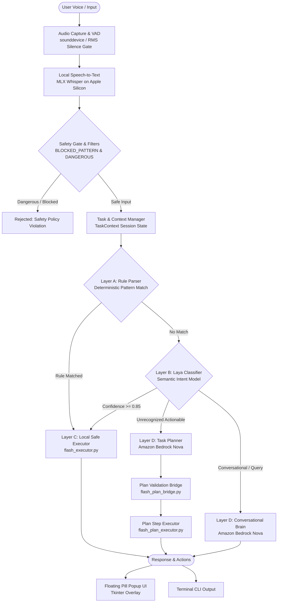

# FLASH AI — System Architecture

FLASH AI is built on a local-first, multi-tiered architecture designed for low-latency desktop assistance on macOS. It combines Apple Silicon hardware acceleration, fast local intent classification, deterministic safety gating, and cloud-based reasoning for complex tasks.

---

## 1. High-Level Architecture Diagram



---

## 2. Architectural Layers

### Layer 0: Speech Pipeline & Audio Capture
- **Module:** `backend/flash_voice_continuous.py`
- **Audio Capture:** Uses `sounddevice` to stream raw 16 kHz 32-bit float mono audio in 100 ms blocks.
- **Bounded Queue:** Audio blocks are passed to a thread-safe queue (`maxsize=50`, ~5 seconds of buffer) with explicit overflow dropping to prevent audio drift during heavy downstream execution.
- **Voice Activity Detection (VAD):** Calculates root-mean-square (RMS) energy against a dynamic noise floor. Once speech starts, it monitors for trailing silence (default: 500 ms configurable via `FLASH_SILENCE_SECONDS`).
- **Transcription Acceleration:** Powered by `mlx-whisper` running quantized Whisper models (`mlx-community/whisper-small-mlx`) locally on Apple Silicon Metal Performance Shaders / Apple Neural Engine.
- **Warmup:** Background worker threads pre-warm model weights during CLI startup, eliminating first-turn latency.

### Layer A: Deterministic Rule-Based Router
- **Module:** `backend/flash_router.py`
- **Exact Pattern Matcher:** Fast regex rules match high-frequency commands (e.g., `"open calculator"`, `"open chrome"`, `"go to youtube"`, `"open notes"`, `"take a photo"`).
- **Safety Allowlist:** Strictly validates targets. Browser navigation is restricted to allowlisted aliases and domains; arbitrary shell metacharacters and Markdown-formatted links are unconditionally rejected.
- **Case Preservation:** Normalizes inputs for matching while preserving the user's original capitalization for note titles, bodies, and messages.

### Layer B: Fast Semantic Intent Classifier (Laya)
- **Module:** `backend/flash_laya_classifier.py`
- **Model:** Leverages the lightweight `laya` transformer router running locally on device.
- **Classification Criteria:** Classifies paraphrased intents (e.g., `"I want to snap a picture"`, `"tell me something funny"`) into allowlisted intent classes with associated probability scores in under 10 ms.
- **Confidence Gate:** Predictions require a minimum confidence of 0.85; uncertain classifications gracefully fall back to Layer D.

### Layer C: Local Safe Action Executor
- **Module:** `backend/flash_executor.py`
- **Safety Invariant:** All process execution uses explicit argument lists (`subprocess.run(argv, shell=False)`), preventing shell injection.
- **Integrations:**
  - **Calculator, Chrome, QuickTime, Photos:** Process launching via macOS `open -a`.
  - **Apple Notes:** Invokes JavaScript for Automation (JXA) scripts via `osascript`, passing note title and body exclusively through environment variables.
  - **Photo Booth:** Distinguishes app launching from capture; triggers shutter via System Events (`key code 49` spacebar), checks macOS Accessibility permissions (`-1719`), and inspects the Photo Booth library to verify file generation.
  - **WhatsApp:** Validates recipient and content, requests explicit user confirmation, and drafts the message via `whatsapp://send` URL scheme with clear disclosure of manual send requirements.
  - **Web Search & Websites:** Validates search queries and domain hosts against security allowlists.

### Layer D: Multi-Step AI Planner & Conversational Brain
- **Modules:** `backend/flash_aws_brain.py`, `backend/flash_ai_planner.py`, `backend/flash_plan_bridge.py`, `backend/flash_plan_executor.py`
- **Foundation Model:** Amazon Bedrock calling Amazon Nova Lite (`us.amazon.nova-2-lite-v1:0`).
- **Conversational Brain:** Handles general knowledge, code assistance, and question answering with short-term turn history (up to 12 exchanges).
- **AI Task Planner:** Converts unstructured natural language into structured multi-step JSON execution plans.
- **Plan Validation Bridge:** Enforces strict execution safety. Validates every action against an allowlist, verifies installed macOS applications dynamically across system directories, and rejects unverified actions before running.

---

## 3. Context, Phase & Task Management

- **Module:** `backend/flash_context.py`
- **Task Lifecycle:**
  ```
  IDLE ──> LISTENING ──> UNDERSTANDING ──> EXECUTING / PLANNING ──> COMPLETED / FAILED
                                │
                                ├──> AWAITING_CONFIRMATION (User confirmation required)
                                └──> AWAITING_CLARIFICATION (Ambiguous target or missing data)
  ```
- **Pronoun & Reference Resolution:** Resolves contextual follow-ups such as `"open it"`, `"open the second one"`, `"continue"`, or `"retry"`. Ambiguous references prompt a clarification question rather than executing unexpected actions.
- **Context Expiration:** Active tasks and conversational targets automatically expire after 180 seconds (configurable) to prevent stale commands from triggering unintended operations.

---

## 4. UI Layer: Dynamic Floating Pill Popup

- **Module:** `backend/flash_voice_popup.py`
- **Implementation:** Borderless floating capsule window built with native Tkinter (`overrideredirect=True`, `-topmost`).
- **Thread Safety:** The UI main loop operates independently from voice capture and network worker threads via a thread-safe message queue.
- **Visual Feedback:**
  - `listening` (Green waveform dot animation)
  - `processing` (Purple pulse)
  - `planning` (Indigo state)
  - `executing` (Blue accent)
  - `speaking` (Amber accent)
  - `completed` (Green checkmark state)
  - `failed` (Red warning state)
